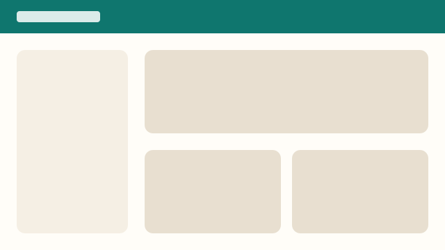

# Projects

Back to the [User guide](../03-guide.md). Next level down: [Sharing a project](projects/sharing.md#invite).

## Create a project
<!-- tags: new project, nuevo proyecto -->

Open **Projects**, then **New project**. Give it a name; you can rename it later.

## Filter the projects
<!-- tags: filter, filtrar -->

The project list has the same filters everywhere; where they live depends on the screen.

<!-- device: desktop -->
**Desktop:**

The filters sit in a column on the left of the list. Right-click a project for its actions.
<!-- /device -->

<!-- device: phone -->
**Phone:**

Tap **Filters**: a bottom sheet slides up. Long-press a project for its actions.
<!-- /device -->

