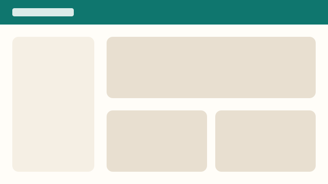

# Sharing a project

Part of [Projects](../projects.md) in the [User guide](../../03-guide.md). See also [Getting started](../../01-getting-started.md#first-steps).

## Invite people
<!-- tags: invitation, invitar -->

Open the project, then **Share**. Invited people get an e-mail and see the project once they sign in.

