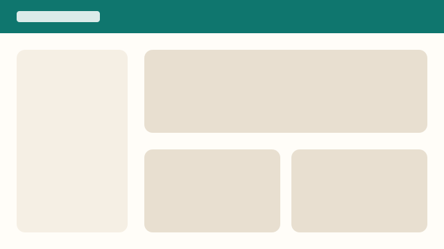

<!-- translation-of: 09a7b3f9b0a9 -->
# Primeros pasos

## Los primeros pasos
<!-- tags: empezar, iniciar sesión -->

Inicia sesión y abre **Manual** en la barra de navegación. Cada capítulo mantiene el idioma elegido; un capítulo que
aún no tiene traducción se muestra en inglés con un aviso.

## Moverse por el manual

Usa la lista de capítulos de la izquierda, el paginador del final o pulsa <kbd>Ctrl</kbd> + <kbd>F</kbd> en el
navegador. Volver al [inicio del manual](../README.md).

<!-- audience: admin -->
**Administradores:** el capítulo de [Administración](../02-admin.md#users) explica las cuentas.
<!-- /audience -->
