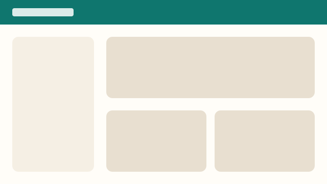

<!-- translation-of: 68cc937af232 -->
# Proyectos

Volver a la [Guía de uso](../03-guide.md). Un nivel más abajo: [Compartir un proyecto](projects/sharing.md#invite).

## Crear un proyecto

Abre **Proyectos** y luego **Nuevo proyecto**.

## Filtrar los proyectos

La lista de proyectos tiene los mismos filtros en todas partes; dónde están depende de la pantalla.

<!-- device: desktop -->
**Escritorio:**

Los filtros están en una columna a la izquierda de la lista. Pulsa con el botón derecho un proyecto para ver sus acciones.
<!-- /device -->

<!-- device: phone -->
**Móvil:**

Toca **Filtros**: se abre una hoja desde abajo. Mantén pulsado un proyecto para ver sus acciones.
<!-- /device -->

